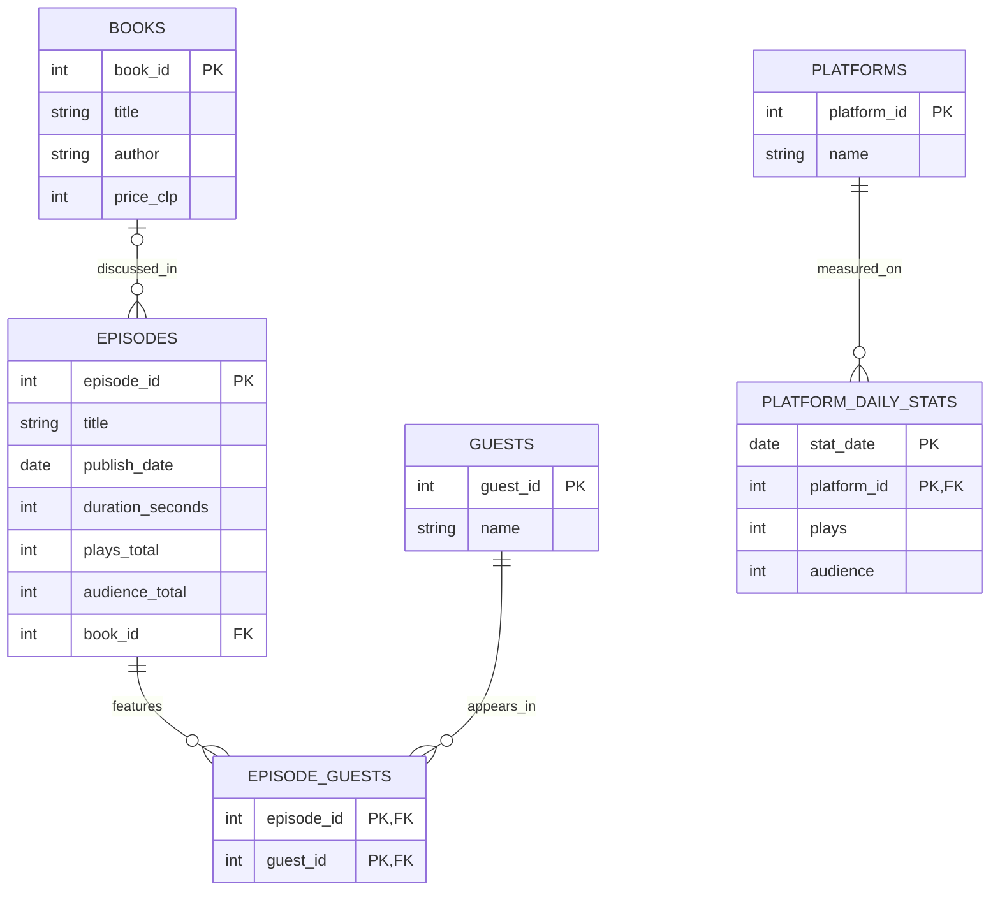

# Database Project — Nota al Margen

## 1. The Scenario

"Nota al Margen" is my Spanish-language literary and cultural podcast. I record it with a co-host, and every Tuesday we publish an episode, usually about one book. The show lives on Spotify. Today the numbers sit in Spotify for Creators dashboards and in a calendar sheet, so I cannot ask simple questions like "do guests bring more plays?" or "did the show grow after a particular month?". This database puts the episodes, the books, the guests and the daily plays in one place.

**What it keeps**
- Episodes: a title, the publish date, the length in seconds, total plays and total audience so far, and the book discussed (if any).
- Books discussed: title, author, and the price in Chilean pesos at Buscalibre Chile (some are empty because I could not find a price).
- Guests: the people who joined an episode beyond the two hosts.
- Platforms the show is on: Spotify, and "other platforms" (everything that is not Spotify).
- For every day and every platform: plays and audience, so I can see growth over time and not only a total.

**The rules it works by**
- An episode's length is more than zero seconds.
- Plays and audience are never negative.
- A book's price is never negative.
- A platform has one row per day in the daily numbers.
- An episode comes out on a Tuesday. *(Not enforced by the database, see section 4.)*

**Business questions**
1. The month in which total plays grew the most compared with the month before.
2. Whether episodes with a guest average more plays than episodes without one.
3. Whether episodes about a book average more plays than episodes that are not about a book.
4. Average plays by episode length (under 45 minutes, 45 to 55, over 55).
5. The day of the week with the most plays on average, using the daily numbers.
6. For each guest, how many episodes they joined, the total plays of those episodes and the books discussed.
7. Every episode that did not come out on a Tuesday, as a check of the Tuesday rule. *(checks a rule)*

## 2. The ERD

## 3. What One Row Means

- One row of `books` is one book discussed in at least one episode.
- One row of `episodes` is one published episode of the show.
- One row of `guests` is one person who has joined the show as a guest.
- One row of `episode_guests` is one guest's appearance on one episode.
- One row of `platforms` is one place where the show is listened to.
- One row of `platform_daily_stats` is the plays and the audience of one platform on one day.

## 4. Design Choices

**Real data, my own keys.** Everything here comes from my show, so the keys are numbers I made up: Spotify only numbered the episodes up to 26, so `episode_id` counts the episodes in publish order. A book gets a `book_id` because the same title can be misspelled between sources and a book has no ISBN in my records. `guests` also uses a made-up `guest_id`, since many guests are known only by a name.

**Optional relationships.** An episode does not need a book, because 14 of the 63 episodes are conversations and not about a book (`book_id` can be empty). An episode does not need a guest, because most are just the two of us. A book can be discussed in more than one episode (*El adversario* is in two). The table `episode_guests` holds the many-to-many link between episodes and guests, with both columns together as its key.

**A rule my tables cannot hold.** "An episode comes out on a Tuesday" could be written as a `CHECK`, but two real episodes (35, on a Monday, and 51, on a Wednesday) would be refused, and they are part of my history. So I check this rule with a query (business question 7) and I keep the two rows. These two rows break the rule on purpose.

**One thing I changed.** The first version of this design used made-up data about listens per episode, platform and snapshot date, with ad revenue. My real data does not have that: Spotify gives me the plays of each day, not of each episode on each day, and I have no ad revenue. I replaced that table with `platform_daily_stats` (one row per day and platform), and I used the price of each book as my money column. The totals of each episode stay in `episodes`. The daily plays and the sum of the episodes' plays do not match exactly (61,405 against 60,862), most likely because the daily numbers also count plays of the trailer and of other items that are not in my episode list.
