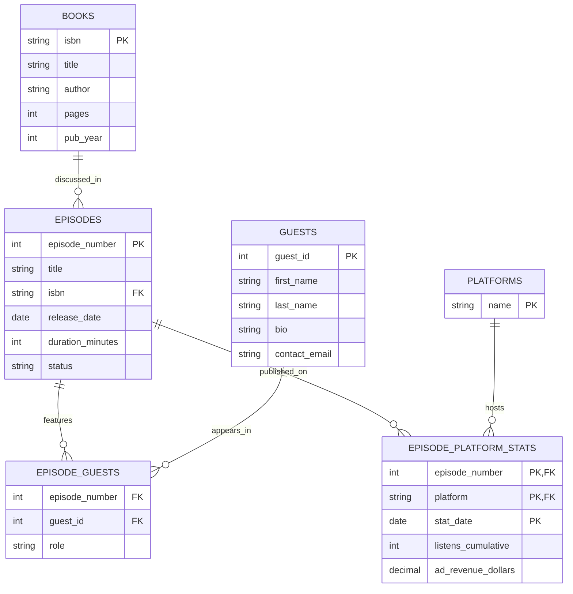

# Database Project — Nota al Margen

## 1. The Scenario

"Nota al Margen" is a Spanish-language literary and cultural podcast, co-hosted by two people, that picks a book to discuss every episode and distributes the show across Spotify, Apple Podcasts and YouTube. Today, episode planning, guest outreach and performance numbers live across a spreadsheet and screenshots from each platform's dashboard. There is no single place to ask whether a guest moves the needle on listens, whether episode length matters, or which day to publish.

**What it keeps today**
- Episodes: a title, the book discussed, the release date, length in minutes, and a status (draft, scheduled or published).
- Books discussed: title, author, page count (the hosts only cover books of at most ~300 pages), and the year published.
- Guests: people who join an episode beyond the two regular hosts — name, a short bio, and contact info, which not everyone gives.
- Platforms the show is distributed on: Spotify, Apple Podcasts, YouTube.
- For every episode, on every platform it is live on: listens and ad revenue, recorded at several points in time, so the show can see growth, not just a current total.

**The rules it works by**
- A book's page count is never more than 300.
- An episode's length in minutes is more than zero.
- An episode's status is one of draft, scheduled or published.
- Listens and ad revenue are never negative.
- An episode marked "published" has to actually be live on at least one platform.

**Business questions**
1. The growth in listens from an episode's first recorded snapshot to its latest, biggest growth first.
2. Whether episodes with a guest average more listens than solo episodes.
3. Average listens by the day of the week an episode was released.
4. Average listens by episode length, to see if there is a sweet spot.
5. Ad revenue per 1,000 listens, by platform.
6. Average listens by book author.
7. Every "published" episode checked against the rule that it has at least one row in `episode_platform_stats`, and a list of any that break it. *(checks a rule)*
8. The month with the largest total growth in listens across all episodes and platforms.

## 2. The ERD

## 3. What One Row Means

- One row of `books` is one book the podcast has discussed or might discuss.
- One row of `episodes` is one episode of the show — draft, scheduled or published.
- One row of `guests` is one person who has joined the show as a guest.
- One row of `episode_guests` is one guest's appearance on one episode.
- One row of `platforms` is one place the show is distributed.
- One row of `episode_platform_stats` is one listens/revenue snapshot for one episode on one platform, on one date.

## 4. Design Choices

